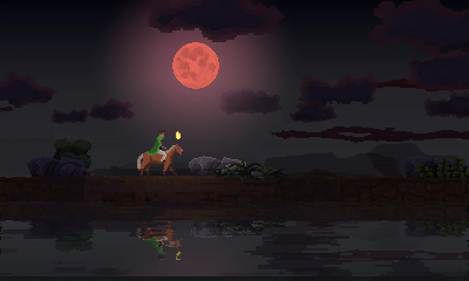

<p align="center">
  
</p>

*Red-moon clouds, forest fog, and water reflections. Captured from this fork’s desktop build at the 3DS top screen’s native 400 × 240 resolution.*

# Kingdom: New Lands for Nintendo 3DS

An unofficial Rust reimplementation of **Kingdom: New Lands**, with a desktop backend for development and a Nintendo 3DS backend. You must supply your own PC copy of the game and convert its assets locally.

**Isaiah Boland (`isaiahboland-dotcom`) created the original Nintendo 3DS port.** Richard (`rzkowskii`) maintains this fork. The gameplay and rendering work here started from Isaiah’s `main` branch at tag `v1.2.0`, commit `74a3bc6`. [Original 3DS port](https://github.com/isaiahboland-dotcom/3ds-kingdom-newlands-port) · [v1.2.0 source](https://github.com/isaiahboland-dotcom/3ds-kingdom-newlands-port/tree/v1.2.0)

Game files, decompiled C# references, extracted art, music, fonts, and level data are excluded from Git. The MIT license in [LICENSE](LICENSE) applies to this project's code; it does not grant rights to the original game or extracted material. Builds containing converted assets are for your own use and should not be uploaded to this repository or its releases.

This project is not affiliated with or endorsed by Raw Fury or Noio. Kingdom and its assets belong to their respective owners.

## What’s in this fork

The port includes island progression, three save slots with shared unlocks, a touch-screen purse and island map, stamina and compass indicators, and a banner editor for the monarch and coat of arms. The 3DS build supports SD saves, DSP audio, and experimental stereoscopic 3D on systems with a 3D slider.

- **Combat and save recovery.** Defeated Greed release stolen coins and tools, squid captives can be rescued, and archers aim at airborne targets. Unreadable, damaged, or incompatible slots are protected from autosaves. A valid backup can resume a run, and recovery preserves the rejected original when it can be read. [Combat and save recovery](docs/p1-fidelity.md)
- **Animation and camera.** The converter preserves prefab transforms and authored animation curves and events. Portal opening, closing, and destruction keep their animation phase through save and resume. Camera lead follows the original timing, with target transitions for the crown, boat, and teleporter. [Asset and animation notes](docs/p2-assets-animation.md) · [Portal and camera notes](docs/p2-remaining-fidelity.md)
- **Siege and flying enemies.** Catapult chassis and wheels recoil under the shot impulse, and boulders launch from the moving arm. Squids scan for citizens, fly around obstacles, carry captives, and retreat. Bosses can pick up a lodged catapult boulder and throw it back. Boulder impacts produce particles and can shake the camera. [Catapult physics](docs/p3-catapult-physics.md) · [Squid flight](docs/p4-squid-flight-retreat.md) · [Boss throwback](docs/p5-boss-throwback.md) · [Boulder impacts](docs/p6-boulder-impact.md)
- **Lighting and weather.** Boss waves can trigger a red moon that fades at dawn. Wind moves the stratus and cumulus layers, and cloud silhouettes cast shadows across the cumulus rims. Foreground fog and low mist follow separate weather presets and appear in water reflections. Firelight warms the fog, and the 3DS accounts for scene depth when drawing through it. Torches, statue fires, and night fires follow their own activation and fade timing. [Red moon](docs/p7-red-moon.md) · [Cloud shadows](docs/p9-cloud-shadows.md) · [Fog and mist](docs/p12-fog-and-mist.md) · [Fog lighting and fire timing](docs/p14-fog-depth-and-fire-timing.md)
- **Cloud shapes and stereo reflections.** Clouds use the six original Unity sprite meshes and evaluate rim lighting per pixel. On 3DS, each stereo eye gets its own cloud shadow mask and water reflection. The reflection pass also includes scenery authored to appear only in the water. [Cloud meshes](docs/p10-tight-cloud-meshes.md) · [Stereo shadows](docs/p11-stereo-cloud-shadows.md) · [Reflections](docs/p2-remaining-fidelity.md#reflections-audio-and-diagnostics-f08f10-f12)
- **Audio and diagnostics.** Coin impacts play from the point of contact. Streamed stereo audio validates both channels before playback and recovers from read failures. On 3DS, render toggles are available only while diagnostics are open. [Audio and diagnostics](docs/p2-remaining-fidelity.md#reflections-audio-and-diagnostics-f08f10-f12)

The latest build passed 290 workspace tests, nine tests using a local PC asset export, and 3DS release packaging. Azahar Vulkan loaded existing saves and exercised stereo clouds, water reflections, and fog depth in both eyes. Physical 3DS rendering, DSP audio, and performance for these changes still need verification. Earlier Old 3DS testing reported stutter during busy coin payouts and construction. The backend requests faster CPU mode where supported. [Stereo validation](docs/p11-stereo-cloud-shadows.md#validation) · [Fog depth and fire validation](docs/p14-fog-depth-and-fire-timing.md#validation) · [Performance notes](docs/perf.md)

### Upgrading an existing build

This fork currently uses asset format **v8** and save format **v12**. Rerun setup to generate `cloud-meshes.bin` and `atmosphere.bin` and rebuild the 3DS RomFS. Setup can reuse the existing local AssetRipper export. Keep the generated world, sprite sheet, and companion assets together. Older v8 packs can load with rectangular clouds and without the fog and mist layers.

Saves refer to the exact `world.bin` they were made with. The cloud mesh, stereo, and atmosphere updates preserve those world bytes, so saves from earlier v8 cloud builds still load. If a conversion changes the world fingerprint, the game preserves the old slot and marks it incompatible. Keep the previous build, converted assets, and a copy of your saves to continue a run tied to a different world. [Save recovery](docs/p1-fidelity.md#save-compatibility-and-recovery) · [Asset compatibility](docs/p12-fog-and-mist.md)

## Installation

There are two ways to build the game: the **automated install** (`build.sh`) installs every dependency and builds everything in one command, while the **manual install** lets you run each step yourself.

### Automated install

Written for Debian/Ubuntu, Fedora, and Arch based distros (including Mint, Pop!_OS, Manjaro, EndeavourOS, and CachyOS). It has only been tested on Arch based distros so far; **Debian and Fedora remain untested**, in particular the automatic devkitPro install (Fedora has no official devkitPro packages, so that route is a best effort). If a step fails there, set `INSTALL_DEPS=no` in `.env`, install the dependencies by hand as described under [Manual install](#manual-install), and run `./build.sh` again; reports are welcome. You need your own PC copy of Kingdom: New Lands; the Steam **Linux** build is what the port is developed against.

```sh
git clone https://github.com/rzkowskii/Kingdom-3DS.git
cd Kingdom-3DS
cp .example.env .env    # optional: edit to change the defaults
./build.sh
```

`build.sh` will, as needed:

1. Install the system packages for your distro (asks for `sudo`).
2. Install Rust with rustup, the nightly toolchain with `rust-src`, and `cargo-3ds`.
3. Install devkitPro's `3ds-dev` tools into `/opt/devkitpro`.
4. Find your game, convert its assets, and build the game (via `tools/setup.sh`).
5. Lay out the SD card files in `dist/sdcard/`, and copy them to your SD card if `SDCARD` is set.

Steps that are already done are skipped, so running it again just rebuilds. Settings in `.env` (all optional, see [`.example.env`](.example.env)):

| Setting | Default | Meaning |
|---|---|---|
| `KINGDOM_GAME` | searched | Game folder containing `Kingdom_Data`. Steam libraries, `~/GOG Games`, and `gamefiles/` are searched when empty. |
| `TARGET` | ask | `desktop`, `3ds` (`.3dsx`), or `cia` (`.3dsx` and `.cia`). Left empty, `build.sh` asks whether to build the `.3dsx` or the `.cia` (the `.3dsx` without a terminal). |
| `INSTALL_DEPS` | `yes` | Set to `no` to only check for dependencies, never install them. |
| `DEVKITPRO` / `DEVKITARM` | `/opt/devkitpro` | Existing devkitPro installation. |
| `ASSETRIPPER` | downloaded | Path to an AssetRipper 2.0.0 executable you already have. |
| `SDCARD` | empty | Mounted SD card (e.g. `/run/media/$USER/3DS`) to copy the result onto. |

Paths may contain spaces without quotes and may use `~` or `$HOME`. Variables already exported in your shell override `.env`. You can also pick the target for one run with `./build.sh desktop`, `./build.sh 3ds`, or `./build.sh cia`, and force a fresh asset rip with `./build.sh --rerip`.

When it finishes, copy everything inside `dist/sdcard/` onto the root of your SD card, merging folders (existing saves are kept). Launch `kingdom.3dsx` from the Homebrew Launcher, or install `cias/kingdom.cia` with FBI. Sound needs your console's DSP firmware at `sdmc:/3ds/dspfirm.cdc` (run DSP1 once). For the desktop target, play with `cargo run --release -p desktop`.

### Manual install

The steps below are what `build.sh` automates.

#### Desktop setup

Run the commands below from the repository root. The asset pipeline was developed against the Steam **Linux Mono build** of Kingdom: New Lands. Other game builds and Windows/macOS hosts have not been fully validated; WSL with a Linux game installation is the recommended starting point on Windows.

Install stable [Rust](https://rustup.rs), Bash, curl, tar with xz support, and the desktop development libraries. On Debian/Ubuntu:

```sh
sudo apt-get update
sudo apt-get install -y build-essential pkg-config libasound2-dev libx11-dev libxi-dev libgl1-mesa-dev curl xz-utils
```

Convert your game and run the desktop backend:

```sh
tools/setup.sh --game "/path/to/Kingdom New Lands"
cargo run --release --locked -p desktop
```

The game directory must contain `Kingdom_Data/globalgamemanagers`. The setup script can also search common Steam libraries if `--game` is omitted, or use `KINGDOM_GAME`. It downloads AssetRipper **2.0.0**, verifies the release archive's SHA-256, exports to `reference/ripped/`, and converts the export into `assets/`. An existing export is reused; use `--rerip` to regenerate it. To use an existing AssetRipper executable, set `ASSETRIPPER` to its path.

```sh
tools/setup.sh --help
```

Extraction does not require decompiling the game scripts yourself. The optional `--decomp` flag requires `ilspycmd` and writes local development references into ignored `reference/decomp/`.

The desktop backend reads `assets/` by default. Set `KINGDOM_ASSETS` to override it. Saves use `KINGDOM_SAVES`, then `$XDG_DATA_HOME/kingdom-3ds`, then `~/.local/share/kingdom-3ds` (or `saves/` if no home directory is available).

#### Building for 3DS

Install [devkitPro](https://devkitpro.org/wiki/Getting_Started) with the `3ds-dev` group, including `tex3ds`, then install the Rust build tools:

```sh
rustup toolchain install nightly --component rust-src
cargo install --locked cargo-3ds
```

The scripts default to `/opt/devkitpro`. Set `DEVKITPRO` and, if needed, `DEVKITARM` for a different installation.

```sh
tools/setup.sh --game "/path/to/Kingdom New Lands" --3ds
```

Outputs:

- `crates/n3ds/target/armv6k-nintendo-3ds/release/kingdom.3dsx`
- `crates/n3ds/sdcard/3ds/kingdom-3ds/audio/`

Copy `crates/n3ds/sdcard/3ds/` into `/3ds/` on the SD card, merging directories, and put `kingdom.3dsx` in `/3ds/` for the Homebrew Launcher. Audio also requires your console's DSP firmware at `sdmc:/3ds/dspfirm.cdc` (the backend suggests running DSP1 if it is missing). Saves live in `sdmc:/3ds/kingdom-3ds/`.

For an installable HOME Menu title:

```sh
tools/setup.sh --game "/path/to/Kingdom New Lands" --cia
```

This also creates `kingdom.cia` beside the `.3dsx`. Install it with a title manager such as FBI and copy the same audio directory to the SD card. Packaging uses `makerom` and `bannertool` from `PATH`, or builds them under `tools/cia/`; this needs Git, make, and a C/C++ compiler. The banner, icon, and jingle are generated from your own game files.

#### Manual conversion and builds

If you already have an AssetRipper 2.0.0 Unity project export at `reference/ripped/ExportedProject`:

```sh
cargo run --release --locked -p extract -- --ripped reference/ripped/ExportedProject --out assets
cargo run --release --locked -p desktop
```

For 3DS, expose devkitPro's tools on `PATH` before packing and building:

```sh
export DEVKITPRO="${DEVKITPRO:-/opt/devkitpro}"
export DEVKITARM="${DEVKITARM:-$DEVKITPRO/devkitARM}"
export PATH="$DEVKITARM/bin:$DEVKITPRO/tools/bin:$PATH"
cargo run --release --locked -p extract --bin pack3ds -- assets crates/n3ds/romfs
(cd crates/n3ds && cargo +nightly 3ds build --release)
```

After packing, `tools/cia/build.sh` builds the `.3dsx` and packages the `.cia`. It reads the original export from `reference/ripped/ExportedProject`; set `RIPPED` to override that location.

The converter generates sprite atlases, animation metadata, font glyphs, audio, and serialized world data. `pack3ds` repacks textures into 3DS formats, puts assets in the ignored RomFS directory, and copies audio into the ignored SD-card staging directory.

## Controls

| Action | Desktop | 3DS |
|---|---|---|
| Walk | Left/Right or A/D | Circle Pad or D-Pad left/right |
| Gallop | Double-tap direction or hold Shift | Double-tap direction or hold B |
| Drop a coin / pay | Space or J | A, L, R, or D-Pad up |
| Drop a coin from the bag | Click the bag | Tap the bag |
| Pause | Escape or Enter | START or touch pause button |
| Choose an island after a run | Left/Right, Enter | Touch, or left/right and A |
| Save | F5 or pause menu | Pause menu |

At a payable, tap to drop a coin or hold to pay. The bottom screen shows the purse, day/night timer, stamina, compass, save menu, and island selection. Open **BANNER** in the pause menu to choose a king or queen and edit the coat of arms. The 3D slider controls depth on the top screen.

For development, use F1 on desktop or SELECT on 3DS to toggle diagnostics. Desktop shortcuts also include 1–4 for simulation speed and I for god mode. On 3DS, SELECT + R + Y toggles god mode.

## Repository and checks

- `crates/game`: simulation, progression, and save data.
- `crates/platform`: platform traits, save-file handling, and diagnostic controls.
- `crates/scene`: shared rendering, UI, audio mixing, and session state.
- `crates/desktop`: macroquad desktop backend.
- `crates/n3ds`: separately built 3DS backend.
- `tools/extract`: local asset conversion and 3DS packaging helpers.
- `build.sh`, `.example.env`: automated install.
- `tools/setup.sh`, `tools/cia/`: setup and CIA packaging.

Checks that do not require game files:

```sh
cargo build --workspace --all-targets --locked
cargo test --workspace --locked
cargo clippy --workspace --all-targets --locked -- -D warnings
shellcheck build.sh tools/setup.sh tools/cia/build.sh
python3 tools/check_public_files.py
```

CI runs these checks and a separate 3DS build with an empty RomFS, which verifies compilation without distributing game data. An empty RomFS build cannot run the game.

Keep game installations in `gamefiles/`, references in `reference/`, and generated data in `assets/`, `dist/`, or the ignored 3DS staging directories. Do not force-add these files or attach asset-containing builds to public releases. Source comments identify original classes and observed behavior for reference; decompiled C# must stay local. See [the publication audit](docs/publication-audit.md) for the scope and limits of the repository checks.
